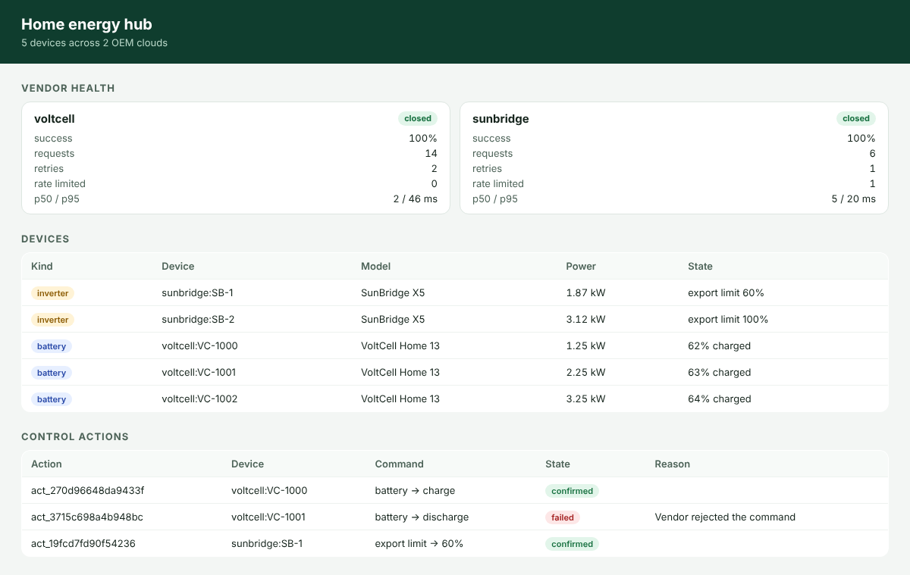

# home-energy-hub

Energy companies want to control home batteries and solar inverters without integrating with every manufacturer's cloud separately. This service puts one API in front of OEM clouds that each have their own auth, units, pagination, rate limits and failure modes. It turns their quirks into consistent telemetry, trackable control actions and signed webhooks.



## What it handles

| Concern | How |
| --- | --- |
| **Different auth per vendor** | VoltCell uses OAuth 2.0 client credentials, with the token cached and refreshed 30 s before expiry. SunBridge uses an API key. |
| **Different units and shapes** | kW versus W, state of charge as 0–1, epoch seconds versus ISO timestamps. Everything is normalised to one `Telemetry` model (W, %, ISO 8601). |
| **Different pagination** | Cursor-based for VoltCell, page/size for SunBridge. Discovery walks every page. |
| **Flaky vendor APIs** | Every vendor call goes through `ResilientClient`. It retries 5xx and network errors with exponential backoff and jitter, honours `Retry-After` on 429, stops on 4xx and applies timeouts. |
| **Vendor outages** | A circuit breaker per vendor opens after consecutive failures, short-circuits calls during the cooldown and probes again half-open. Discovery keeps devices from healthy vendors when one is down. |
| **Asynchronous commands** | Commands return a vendor reference. Actions stay `pending` until reconciliation sees the vendor confirm, reject or miss the deadline (`confirmed`, `failed`, `timed_out`). A brief vendor outage doesn't fail an action; it's polled again later. |
| **Telling customers** | Settled actions are delivered as webhooks signed with HMAC-SHA256 over timestamp and body (`t=…,v1=…`), with retries. `verify()` enforces a freshness window and uses a constant-time comparison. |
| **Knowing what's broken** | Per-vendor requests, failures, retries, rate limits, short-circuits, p50/p95 latency and breaker state at `/vendors/health` and on the dashboard. |

The two OEM clouds are realistic fakes in `src/fakes` with fault injection (5xx, 429 with `Retry-After`). Tests and the demo exercise the real HTTP paths, not mocks of the adapters.

## Tech stack

Node.js 22, TypeScript (strict), Fastify, zod, vitest, Docker, GitHub Actions. It ships as a container and takes its configuration from the environment.

## Running it

```bash
npm ci
npm run demo                 # starts both fake OEM clouds with injected faults and the hub on :3000
open http://localhost:3000
```

Against real vendors:

```bash
VOLTCELL_URL=… VOLTCELL_CLIENT_ID=… VOLTCELL_CLIENT_SECRET=… \
SUNBRIDGE_URL=… SUNBRIDGE_API_KEY=… \
WEBHOOK_URL=https://you.example/hooks WEBHOOK_SECRET=… \
npm run build && npm start
```

| Endpoint | |
| --- | --- |
| `POST /devices/sync` | Discover devices across all vendors; reports vendors that failed |
| `GET /devices` | Known devices |
| `GET /devices/:id/telemetry` | Normalised live telemetry |
| `POST /devices/:id/actions` | `{"type":"battery_mode","mode":"charge","powerW":3000}` or `{"type":"export_limit","percent":60}` returns `202` |
| `GET /actions/:id` | Action state and failure reason |
| `GET /vendors/health` | Per-vendor reliability metrics and breaker state |

## Tests

```bash
npm run typecheck
npm test     # resilience, adapters against fake OEM servers, action lifecycle, webhooks, HTTP API
```

## License

MIT
